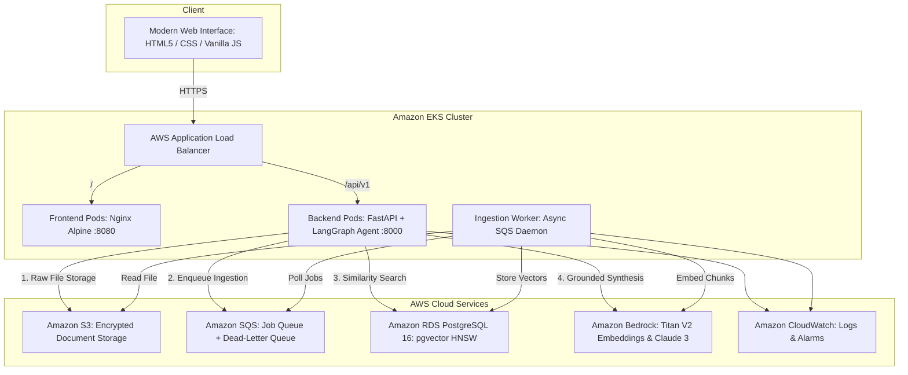

# Production-Ready Agentic RAG Application on AWS EKS

[](https://github.com/bittush8789/agentic-rag-bedrock-eks/actions/workflows/ci.yaml)
[](LICENSE)
[](https://kubernetes.io)
[](https://aws.amazon.com/eks/)
[](https://aws.amazon.com/bedrock/)
[](https://github.com/pgvector/pgvector)
[](https://langchain-ai.github.io/langgraph/)

An enterprise-grade, multi-tenant **Agentic Document Intelligence Platform** built from scratch for secure document ingestion, grounded vector retrieval, citation validation, and automated GitOps deployment on **Amazon EKS**.

---

## 🏛️ Architecture Overview


<details>
<summary><b>View Architecture Data Flow (Mermaid Diagram)</b></summary>



</details>

---

## ✨ Key Highlights

- **Pure Vanilla Frontend**: Zero heavy JavaScript frameworks. Clean, accessible HTML5, CSS3, and ES6+ JS with dark theme, real-time ingestion status badges (`QUEUED`, `PROCESSING`, `READY`, `FAILED`), verified source citation cards, and drag-and-drop file upload.
- **FastAPI Async Backend**: High-performance REST API (`/api/v1`) with Pydantic v2 schemas, correlation ID tracking (`X-Request-ID`), RFC-compliant errors, and structured JSON logging.
- **Bounded LangGraph Workflow**: 7-step deterministic state machine with prompt injection defense, tenant-isolated vector retrieval, relevance grading, bounded query refinement, grounded synthesis, strict citation validation, and response formatting.
- **Asynchronous Ingestion**: Decoupled document processing via Amazon S3, Amazon SQS + DLQ, and dedicated Python worker daemon with checksum deduplication and exponential backoff.
- **pgvector Vector Database**: PostgreSQL 16 with HNSW vector indexing (`m=16, ef_construction=64`) storing 1024-dimension Amazon Titan Text Embeddings V2.
- **Multi-Tenant Security**: Strict query partitioning by `tenant_id`, prompt injection guards, non-root containers, read-only root filesystems, and AWS IAM / Pod Identity least privilege.
- **Infrastructure as Code & GitOps**: Modular Terraform (`vpc`, `security_groups`, `ecr`, `s3`, `sqs`, `rds`, `iam`, `eks`), Helm 3 charts (HPA, PDB, NetworkPolicies, ALB Ingress), and Argo CD automated synchronization.
- **Full Observability & Benchmarks**: Prometheus metrics, Grafana dashboards, CloudWatch alarms, and an automated RAG evaluation benchmark runner.

---

## 🛠️ Technology Stack

| Layer | Technologies |
| :--- | :--- |
| **Frontend** | HTML5, CSS3, Vanilla JavaScript (ES6+), Nginx Unprivileged |
| **Backend API** | Python 3.12, FastAPI, Pydantic v2, Uvicorn, SQLAlchemy 2.0 (Async) |
| **AI & Agentic RAG** | Amazon Bedrock (Claude 3 Haiku & Titan Embeddings V2), LangGraph, pgvector, PyPDF |
| **Database & Storage** | Amazon RDS PostgreSQL 16 with pgvector, Amazon S3 (AES-256 / KMS) |
| **Queue & Messaging** | Amazon SQS with Dead-Letter Queue (DLQ) |
| **Infrastructure & K8s** | Terraform >= 1.5, AWS EKS v1.31, EKS Pod Identity, AWS ALB Controller |
| **CI/CD & GitOps** | GitHub Actions, Trivy Security Scanning, Amazon ECR, Helm 3, Argo CD |
| **Observability** | Prometheus, Grafana, OpenTelemetry, Amazon CloudWatch |

---

## 📂 Repository Layout

```
.
├── frontend/               # Vanilla JS/CSS/HTML web client & Nginx Dockerfile
├── backend/                # FastAPI application, LangGraph RAG agent, Alembic migrations
│   ├── app/
│   │   ├── api/v1/         # Documents, RAG chat, conversations, health endpoints
│   │   ├── core/           # Config, structured logging, security & tenant auth
│   │   ├── db/             # SQLAlchemy async engine & Base
│   │   ├── models/         # Document, Chunk, Conversation, Job, Audit models
│   │   ├── schemas/        # Pydantic v2 request/response contracts
│   │   ├── rag/            # LangGraph agent, Bedrock client, chunker, vector store
│   │   └── services/       # Ingestion pipeline, storage, document & chat services
│   └── alembic/            # Database schema migrations
├── worker/                 # Dedicated SQS ingestion daemon & Dockerfile
├── infrastructure/         # Reusable Terraform modules & environments (dev, prod)
├── deploy/                 # Helm chart (agentic-rag) & Argo CD application manifests
├── observability/          # Prometheus scrape configs, alerts & Grafana dashboards
├── evaluation/             # RAG benchmark dataset and automated evaluation runner
├── tests/                  # Pytest unit & integration test suite (100% pass)
├── docs/                   # Complete documentation suite (13 detailed guides)
├── docker-compose.yml      # Local multi-container development environment
├── Makefile                # Standard engineering workflow targets
└── README.md
```

---

## 🚀 Quickstart

### 1. Local Full-Stack with Docker Compose (Fastest)

```bash
# Clone the repository
git clone https://github.com/bittush8789/agentic-rag-bedrock-eks.git
cd agentic-rag-bedrock-eks

# Create environment configuration
cp .env.example .env

# Launch PostgreSQL (pgvector), Backend, Worker, and Frontend
docker compose up --build -d
```

- **Web Application**: [http://localhost:8080](http://localhost:8080)
- **Interactive API Docs**: [http://localhost:8000/docs](http://localhost:8000/docs)
- **Health Check**: `curl http://localhost:8000/health`

### 2. Run Tests & AI Evaluation Benchmarks

```bash
# Run unit & integration tests (offline with mock vectors)
pytest tests/ -v

# Run AI Grounding & Faithfulness Evaluation
python evaluation/evaluate.py
```

> 📖 **Need step-by-step commands?**  
> Check the **[End-to-End Setup & Running Guide](docs/setup_and_running_guide.md)** for local virtualenv setup, cloud Terraform provisioning, Amazon ECR publishing, EKS Helm deployment, and Argo CD GitOps.

---

## 📚 Documentation Hub

All detailed architectural, operational, and deployment manuals are maintained in the [`docs/`](docs/) directory:

| Document | Description |
|---|---|
| **[Setup & Running Guide](docs/setup_and_running_guide.md)** | **Complete step-by-step commands for Local, Docker, Terraform, ECR, and EKS** |
| **[Architecture & Data Flows](docs/architecture.md)** | Deep-dive system design, LangGraph state machine, and data lifecycle |
| **[REST API Reference](docs/api.md)** | Complete OpenAPI specifications, request/response contracts, and error codes |
| **[Database & pgvector](docs/database.md)** | PostgreSQL schema, HNSW indexing parameters, and tenant isolation |
| **[EKS Deployment Guide](docs/eks_deployment.md)** | Helm packaging, AWS Load Balancer Controller, and rollback procedures |
| **[Terraform Guide](docs/terraform.md)** | Infrastructure modules, state management, and dev/prod configurations |
| **[GitOps with Argo CD](docs/gitops_argocd.md)** | Continuous delivery setup, sync policies, and drift detection |
| **[Security & Threat Model](docs/security_threat_model.md)** | STRIDE analysis, prompt injection defense, and IAM least privilege |
| **[Observability & Monitoring](docs/observability.md)** | Prometheus metrics, Grafana dashboards, and CloudWatch alarms |
| **[Operational Runbooks](docs/runbooks.md)** | Standard operating procedures, deployment rollouts, and incident response |
| **[Troubleshooting Guide](docs/troubleshooting.md)** | Diagnostic playbooks for ingestion failures, Pod crashes, and latency |
| **[Cost Optimization (FinOps)](docs/cost_optimization.md)** | AWS resource sizing, Spot instances, and Bedrock token optimization |
| **[Disaster Recovery](docs/disaster_recovery.md)** | RPO/RTO targets, multi-AZ failover, S3 replication, and backup strategy |

---

## 📄 License

This project is licensed under the [MIT License](LICENSE).
