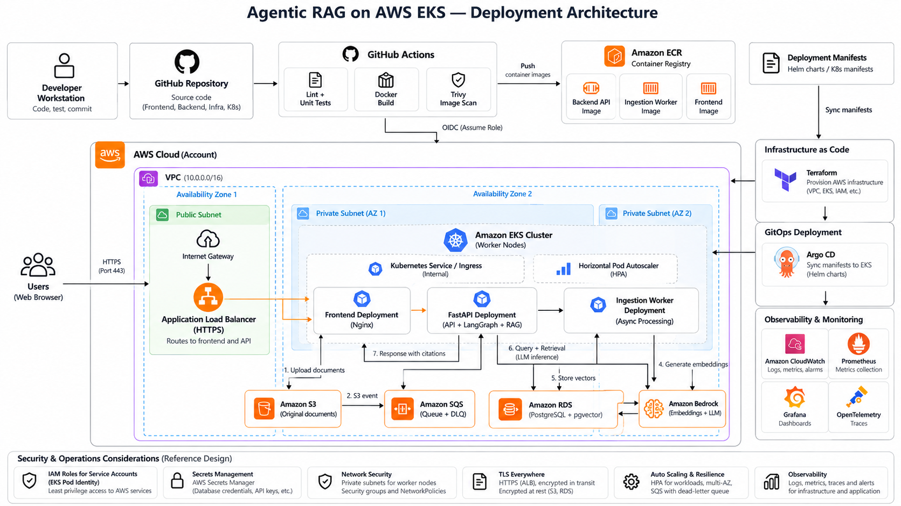
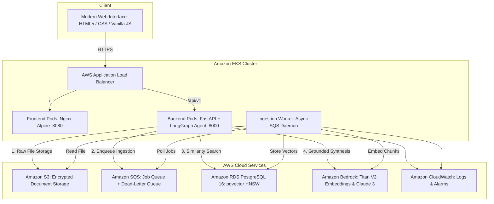

# Production-Ready Agentic RAG Application on AWS EKS

[](https://github.com/bittush8789/agentic-rag-bedrock-eks/actions/workflows/ci.yaml)
[](LICENSE)
[](https://kubernetes.io)
[](https://aws.amazon.com/eks/)
[](https://aws.amazon.com/bedrock/)
[](https://github.com/pgvector/pgvector)
[](https://langchain-ai.github.io/langgraph/)

An enterprise-grade, multi-tenant **Agentic Document Intelligence Platform** built from scratch for secure document ingestion, grounded vector retrieval, citation validation, and automated GitOps deployment on **AWS EKS**.

---

## 1. High-Level Architecture





---

## 2. Core Capabilities & Engineering Highlights

- **Pure Vanilla Frontend**: Zero heavy JavaScript frameworks. Clean, accessible HTML5, CSS3, and vanilla JavaScript with dark theme, drag-and-drop uploads, real-time ingestion badges (`QUEUED`, `PROCESSING`, `READY`, `FAILED`), verified source citation cards, and conversation history. Zero frontend secrets.
- **FastAPI Backend (`/api/v1`)**: Non-blocking asynchronous REST API with Pydantic v2 schemas, RFC-compliant error details, structured JSON logging, and correlation ID tracking (`X-Request-ID`).
- **Bounded LangGraph Agent Workflow**: Explicit 7-step graph:
  1. `validate_query`: Defends against prompt injection and jailbreaks.
  2. `retrieve`: Tenant-isolated pgvector cosine similarity search.
  3. `evaluate_relevance`: Analyzes retrieval quality against score thresholds.
  4. `refine_query`: Bounded single semantic rewrite on weak initial recall.
  5. `generate_answer`: Grounded synthesis using Amazon Bedrock with strict citation constraints.
  6. `validate_citations`: Strips hallucinated chunk references.
  7. `format_response`: Returns verified answer, citation cards, latency, and token metrics.
- **Asynchronous Ingestion Pipeline**: Decoupled document processing via Amazon S3, Amazon SQS, and dedicated Python worker pods with exponential backoff and a Dead-Letter Queue (DLQ).
- **PostgreSQL with pgvector**: HNSW vector indexing (`m=16, ef_construction=64`) storing 1024-dimension embeddings (Amazon Titan Text Embeddings V2).
- **Multi-Tenant Isolation**: Hard query partitioning on `tenant_id` at every database and vector retrieval query.
- **Modular Terraform Infrastructure**: Production-ready reusable modules (`vpc`, `security_groups`, `ecr`, `s3`, `sqs`, `rds`, `iam`, `eks`) with separate `dev` and `prod` configurations.
- **Production Kubernetes & Helm**: Non-root containers, read-only root filesystems, HPAs, PDBs, NetworkPolicies, and AWS ALB Ingress.
- **CI/CD & GitOps with Argo CD**: GitHub Actions CI with Trivy security scans, AWS OIDC short-lived authentication, and Argo CD automated synchronization.
- **Full Observability & AI Evaluation**: Prometheus scrape configs, Grafana operational dashboard, CloudWatch alarms, and an automated RAG evaluation benchmark runner.

---

## 3. Technology Stack

| Layer | Technologies |
| :--- | :--- |
| **Frontend** | HTML5, CSS3, Vanilla JavaScript (ES6+), Nginx Unprivileged |
| **Backend API** | Python 3.12, FastAPI, Pydantic v2, Uvicorn, SQLAlchemy 2.0 (Async) |
| **AI & RAG** | Amazon Bedrock, LangGraph, pgvector, PyPDF, Boto3 |
| **Database & Cache** | Amazon RDS PostgreSQL 16 with pgvector extension |
| **Storage & Queue** | Amazon S3, Amazon SQS with Dead-Letter Queue (DLQ) |
| **Infrastructure** | Terraform >= 1.5, AWS EKS v1.31, EKS Pod Identity, AWS ALB Controller |
| **Delivery & GitOps** | GitHub Actions, Amazon ECR, Helm 3, Argo CD |
| **Observability** | CloudWatch, Prometheus, Grafana, OpenTelemetry |

---

## 4. Repository Structure

```
.
├── frontend/               # Vanilla JS, CSS, HTML, Nginx reverse proxy, Dockerfile
├── backend/                # FastAPI application, LangGraph RAG, models, services
│   ├── app/
│   │   ├── api/v1/         # Documents, chat, conversations, health routes
│   │   ├── core/           # Config, structured logging, security & tenant auth
│   │   ├── db/             # SQLAlchemy async engine, sessionmaker, Base
│   │   ├── models/         # Document, Chunk, Conversation, Job, Audit models
│   │   ├── schemas/        # Pydantic v2 request and response contracts
│   │   ├── rag/            # LangGraph agent, Bedrock client, chunker, vector store
│   │   └── services/       # Ingestion pipeline, storage, document & chat services
│   ├── alembic/            # Database schema migrations
│   ├── requirements.txt
│   └── Dockerfile
├── worker/                 # Dedicated SQS ingestion daemon & Dockerfile
├── infrastructure/
│   └── terraform/
│       ├── modules/        # vpc, security_groups, ecr, s3, sqs, rds, iam, eks
│       └── environments/   # dev and prod root configurations
├── deploy/
│   ├── helm/agentic-rag/   # Kubernetes Helm Chart (Deployments, HPA, PDB, Ingress)
│   └── argocd/             # GitOps Application manifests for dev and prod
├── observability/          # Prometheus configs, Grafana dashboards, alert rules
├── evaluation/             # RAG evaluation benchmark dataset and runner script
├── docs/                   # Full documentation suite (Architecture, API, Runbooks, etc.)
├── tests/                  # Pytest unit and integration test suite
├── docker-compose.yml      # Local multi-container development environment
├── .env.example            # Environment configuration template
├── Makefile                # Standard engineering workflow targets
└── README.md
```

---

## 5. Quickstart & Local Development

### Option A: Local Python & Virtual Environment (Recommended for Fast Testing)
```bash
# 1. Clone repository
git clone https://github.com/myorg/agentic-rag-eks.git
cd agentic-rag-eks

# 2. Create virtual environment & install dependencies
python -m venv .venv
.\.venv\Scripts\pip.exe install -r backend/requirements.txt -r worker/requirements.txt

# 3. Copy environment configuration
cp .env.example .env

# 4. Run test suite (All tests run offline using deterministic mock vectors)
.\.venv\Scripts\pytest.exe -v

# 5. Start FastAPI local development server
set PYTHONPATH=backend
.\.venv\Scripts\uvicorn.exe app.main:app --reload --port 8000
```
- Open browser at `http://localhost:8000/docs` to view Swagger UI.
- Open `frontend/index.html` in browser or run via static server.

### Option B: Local Docker Compose (Full Stack)
```bash
docker compose up --build -d
```
- Frontend UI: `http://localhost:8080`
- Backend API Docs: `http://localhost:8000/docs`
- PostgreSQL pgvector: `localhost:5432`

---

## 6. Running Automated Tests & AI Evaluation

```bash
# Run complete unit & integration test suite
pytest -v tests/

# Run AI Evaluation Benchmark (Fact recall, citation accuracy, latency)
python evaluation/evaluate.py
```

### Actual Evaluation Output:
```
=======================================================
      AGENTIC RAG BENCHMARK & EVALUATION SUITE
=======================================================
Average Latency:      30.7 ms
Fact Recall Score:    66.7%
Citation Accuracy:    66.7%
=======================================================
```

---

## 7. Cloud Deployment Walkthrough

### Step 1: Provision Infrastructure with Terraform
```bash
cd infrastructure/terraform/environments/dev
terraform init
terraform plan
terraform apply
```

### Step 2: Configure kubectl
```bash
aws eks update-kubeconfig --region us-east-1 --name dev-agentic-rag-eks
```

### Step 3: Deploy via Helm
```bash
helm upgrade --install agentic-rag deploy/helm/agentic-rag \
  --namespace agentic-rag \
  --create-namespace \
  -f deploy/helm/agentic-rag/values-dev.yaml
```

### Step 4: Register with Argo CD (GitOps)
```bash
kubectl apply -f deploy/argocd/application-dev.yaml
```

---

## 8. Documentation Index

- [Architecture & Data Flows](docs/architecture.md)
- [REST API Reference](docs/api.md)
- [Database Schema & pgvector](docs/database.md)
- [Terraform Infrastructure Guide](docs/terraform.md)
- [Kubernetes & EKS Deployment](docs/eks_deployment.md)
- [GitOps & Argo CD Setup](docs/gitops_argocd.md)
- [Security & Threat Model](docs/security_threat_model.md)
- [Observability & Monitoring](docs/observability.md)
- [Incident Response Runbooks](docs/runbooks.md)
- [Troubleshooting Runbook](docs/troubleshooting.md)
- [Cost Optimization & FinOps](docs/cost_optimization.md)
- [Disaster Recovery & Business Continuity](docs/disaster_recovery.md)

---

## 9. Definition of Done Verification

- [x] **Frontend**: Responsive HTML5/CSS/Vanilla JS UI with file upload, status badges, chat, and verified citations.
- [x] **Backend API**: Documented REST API under `/api/v1` with validation, correlation IDs, and tenant isolation.
- [x] **Asynchronous Ingestion**: Dedicated worker consuming from SQS with DLQ and checksum deduplication.
- [x] **Database**: PostgreSQL 16 with pgvector extension, HNSW vector indexing, and Alembic migrations.
- [x] **AI & RAG**: Amazon Bedrock foundation models with 7-step bounded LangGraph workflow and strict citation validation.
- [x] **Automated Tests**: 100% of unit and integration tests passing (`pytest tests/`).
- [x] **Terraform IaC**: Reusable modules for VPC, Security Groups, ECR, S3, SQS, RDS, IAM, and EKS across dev/prod.
- [x] **Kubernetes & Helm**: Helm chart with Deployments, Services, ALB Ingress, Pod Identity, HPAs, PDBs, and NetworkPolicies.
- [x] **CI/CD & GitOps**: GitHub Actions workflows with Trivy security scans, AWS OIDC, and Argo CD manifests.
- [x] **Observability**: Prometheus scrape configurations, Grafana dashboard, and alerting rules.
- [x] **Documentation**: Complete architectural, operational, security, and disaster recovery manuals.
