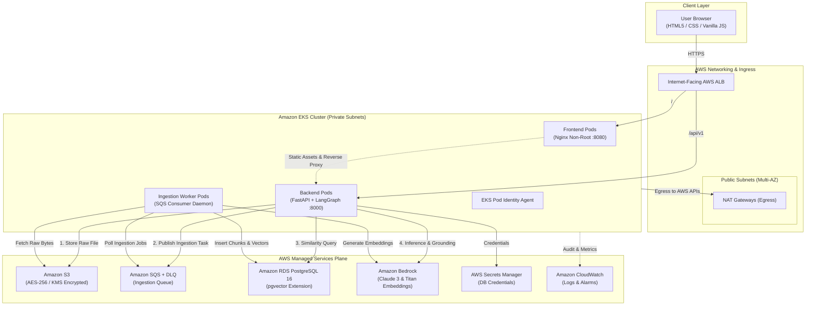
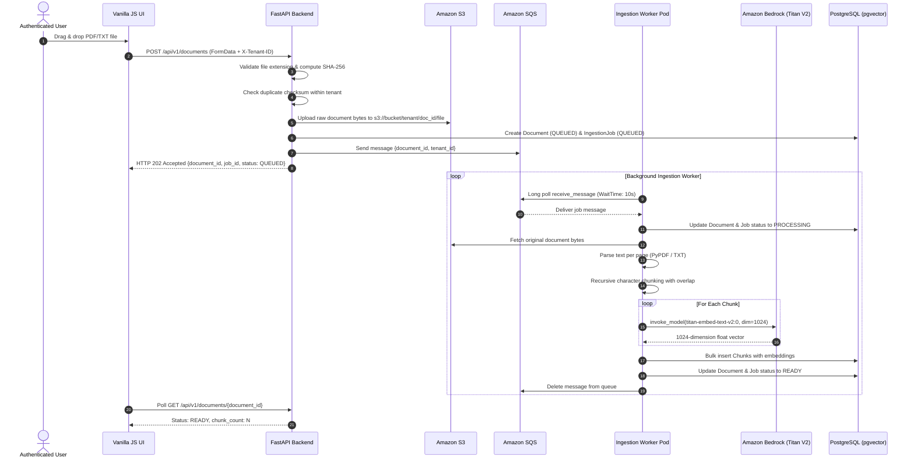
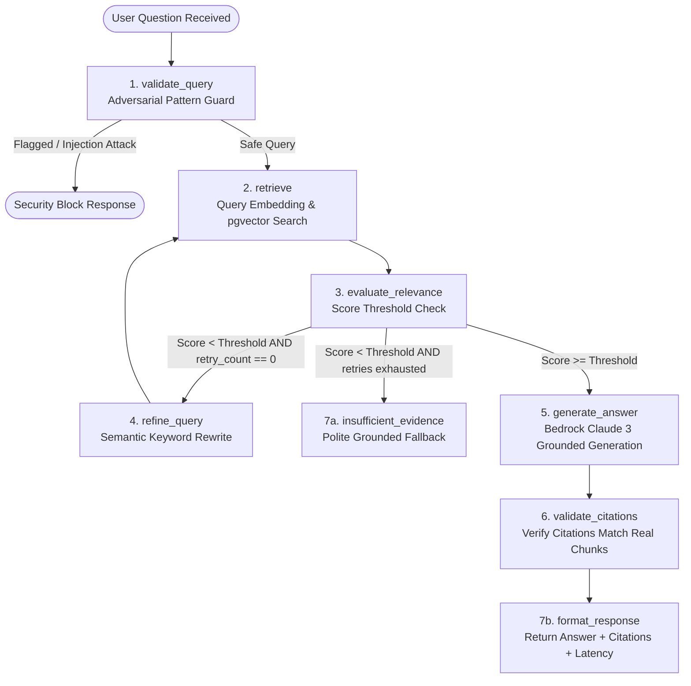

# Architecture & System Design

## 1. High-Level Architecture Overview

The **Enterprise Agentic Document Intelligence Platform** is built as a resilient, multi-tenant cloud-native application on **AWS EKS**, leveraging **Amazon Bedrock** for foundation models and **PostgreSQL with pgvector** for vector storage.

---

## 2. Document Ingestion Flow

The document ingestion pipeline processes files asynchronously to guarantee zero HTTP request timeouts on large documents.

---

## 3. Question Answering & LangGraph Agent Flow

Every user inquiry goes through an explicit, bounded 7-step LangGraph workflow defending against prompt injection and validating source citations.

---

## 4. GitOps & Platform Delivery Pipeline

Infrastructure and application code follow strict separation of concerns:

```mermaid
graph LR
    Dev([Developer]) -->|Git Push| Repo[GitHub Monorepo]
    Repo -->|PR Trigger| CI[GitHub Actions CI<br>Lint, Bandit, Pytest, Trivy]
    CI -->|Pass| Merge[Merge to Main]
    Merge -->|CD Pipeline| CD[GitHub Actions CD<br>Build Docker & Push to ECR]
    CD -->|Update Helm Image Tag| GitOpsRepo[GitOps Branch / Manifests]
    GitOpsRepo -->|Continuous Sync| ArgoCD[Argo CD on EKS]
    ArgoCD -->|Rolling Upgrade| EKSWorkloads[EKS Pods: Frontend, Backend, Worker]
```

